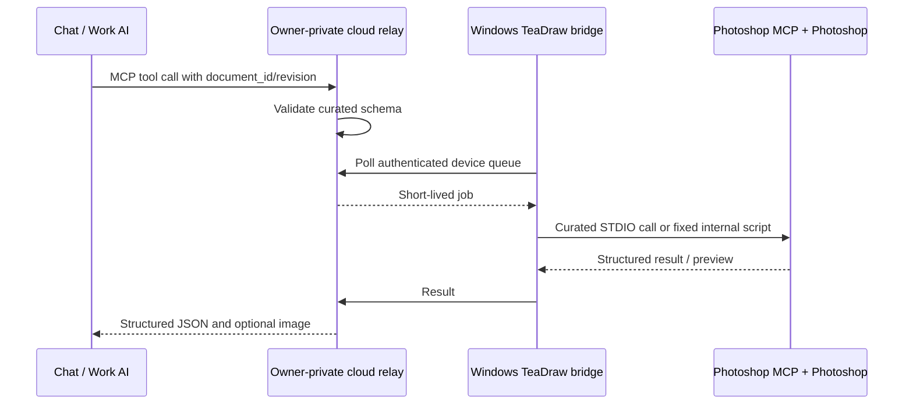

# Architecture

TeaDraw MCP has three trust zones:

## Cloud relay

The relay validates all tool arguments before a job reaches the device. It does not contain Photoshop credentials and cannot open local files by path. R2 records expire and are removed after completion.

## Windows bridge

The bridge makes outbound HTTPS requests only. It does not listen on a public network interface. Its device credential is DPAPI-encrypted and the service origin is pinned to the hostname stored inside that encrypted configuration.

The bridge exposes fixed internal ExtendScript snippets for operations that the upstream MCP does not provide directly. No caller-controlled script text is accepted.

## Revision engine

`collab-runtime.cjs` samples short read-only signatures outside Photoshop's main scripting call. A long poll repeatedly performs short samples instead of running a sleeping ExtendScript program, so Photoshop remains interactive.

Each observed signature can advance a persisted monotonic revision. A wait cursor prevents duplicate delivery, while `expected_revision` protects edits from stale visual context.

## Preview flow

Full and region previews are generated as temporary JPEG files on the device. The bridge reads them into the MCP image result and deletes the temporary file before returning. Region previews are capped to stay below the relay result-size limit.
